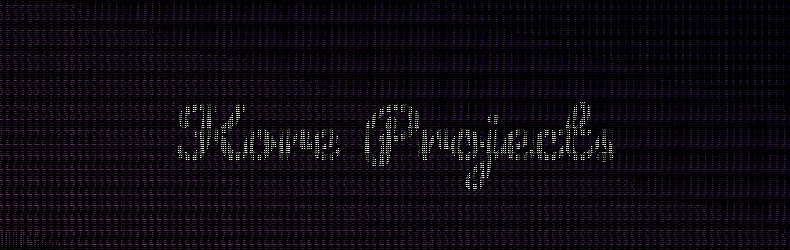
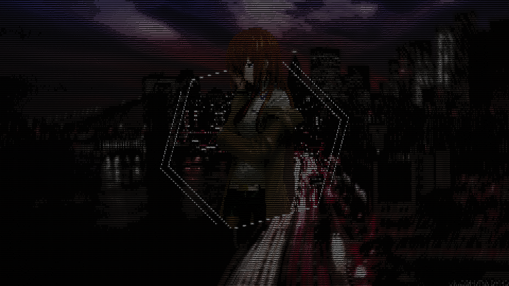
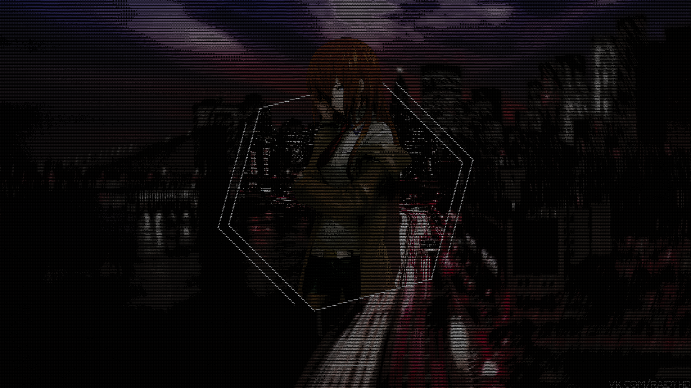
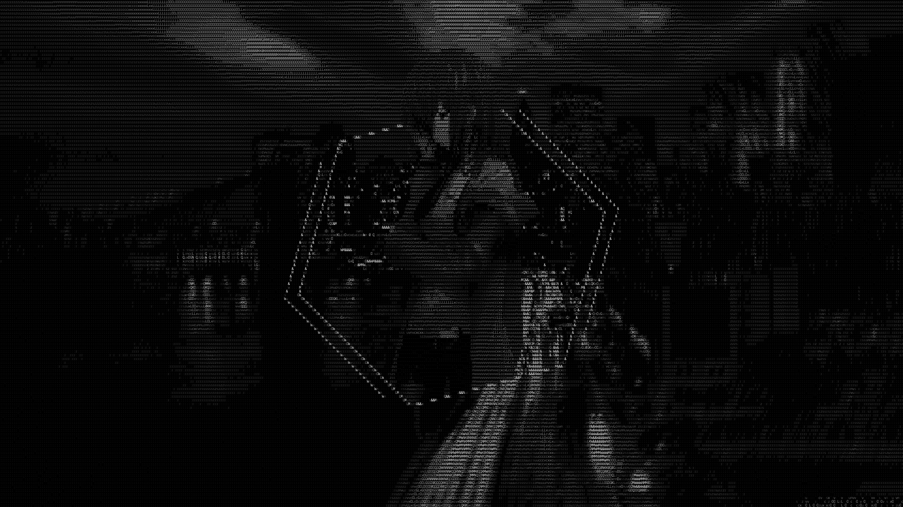
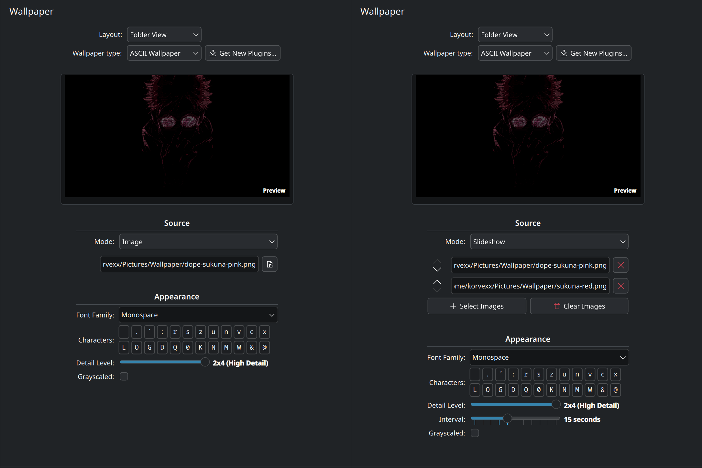

  <h1 style="margin-bottom: 0;">ASCII Wallpapers</h1>
    

         
        
        
    

     
    

        ASCII Wallpapers is a wallpaper addon for KDE Plasma transforming any static image into ASCII-Art. 
        Choose your font and character set, adjust detail-level and grayscale and switch between image and slideshow mode!
    

     

<h3>Preview of the addon</h3>

<table style="border: none;">
<tr>
<!-- Low res-->
<td align="center">

<strong>Low Detail</strong></td>
<!-- Medium res-->
<td align="center">

<strong>Medium Detail</strong></td>
</tr>
<tr>

<!-- High res-->
<td align="center">

<strong>High Detail</strong></td>

<!-- Grayscaled-->
<td align="center">

<strong>Grayscale Mode</strong></td>
</tr>
</table>

<em>The Wallpaper Settings Configuration Page</em>

<h3>How does it work?</h3>

    

    Using a GLSL shader, the wallpaper is converted to ASCII in real-time. 
    The steps to achieve the ASCII-fication are quite simple:
    

    <ul>
        <li><strong>Atlas Generation:</strong> When the wallpaper is loaded, a hidden `canvas` element draws the sequence of ASCII characters from darkest to lightes in the selected detail size onto a texture strip which is called an <strong>Atlas</strong>.</li>
        <li><strong>Grid Sampling:</strong> The shader divides the screen into a grid which is based on the chosen <strong>Detail Level</strong>. It samples the color of the original image at the center of each grid cell to determine the color for that character</li>
        <li><strong>Intensity Mapping:</strong> The shader calculates the brightness of the sampled color acting as an index to pick the most appropriate character from the Atlas.</li>
        <li><strong>Final Render:</strong> Each grid cell is masked by the chosen character. If <strong>Grayscale</strong> is enabled, the original color is desaturated before being multiplied by the character mask, resulting in the final output.</li>
    </ul>

<h3>How to use it</h3>

    <ol>
        <li>Navigate: <strong>System settings > Wallpaper</strong></li>
        <li>Set <strong>Wallpaper type</strong> to "ASCII Wallpaper"</li>
        <li>Select a Wallpaper</li>
        <li>Adjust <strong>Detail level</strong> and <strong>Grayscale</strong> if wanted</li>
        <li>Click apply</li>
    </ol>

<h3>Donations</h3>

I develop projects like <strong>ASCII Wallpapers</strong> in my free time, so if you enjoy this addon and want to support me and my projects, consider donating so that I can dedicate more time to mainting my projects and creating new ones!

  
  
  

