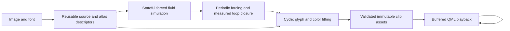

# Animated forced-flow playback — implementation proposal

**Implemented:** see [the implementation and review guide](flow-playback.md). This document preserves the original proposal and its alternatives. The implementation uses a temporal overlap boundary with independent forcing time scales, rather than assuming a forcing-locked periodic orbit.

Extend `style="flow"` with an offline-generated animation clip for each source image. Plasma plays the prepared glyph/color maps in a continuous loop using the existing atlas and frame buffers. Simulation, glyph selection, and color fitting stay in Python. The source image and character grid remain fixed; the evolving flow changes the glyph geometry while colors continue to reproduce the source.

The user selected prepared looping frames. Existing saved profiles retain static rendering unless animation is enabled. A newly enabled animation should produce a clip that passes both motion and seam checks before it replaces the displayed generation.

The main architectural decision is to treat a loop as a cyclic sequence throughout the pipeline. A periodic force, a periodic fluid state, and a smoothly repeating sequence of discrete glyphs are three different requirements. Closing only one is insufficient.



**Current behavior and extension points**

| Existing component | Current behavior | Planned extension |
| --- | --- | --- |
| `ascii_optimizer/flow.py` | `simulate_flow()` prepares a padded periodic domain, runs 64 steps with constant forcing, and returns a cropped snapshot. | Retain the complete simulation state, expose stepping and sampling, and generate a time-periodic clip. |
| `glyph_flow_costs()` | Recomputes atlas raster descriptors alongside field descriptors for one frame. | Cache atlas descriptors and compute only the changing field descriptors per frame. |
| `ascii_optimizer/cli.py` | `solve_style()` simulates and solves one grid; `build()` writes stills and slideshow transitions. | Accept externally prepared flow costs and orchestrate clip generation without restarting the simulation for each frame. |
| `ascii_optimizer/optimizer.py` | Fits glyphs and colors against a static target. Its existing temporal terms require both `previous` and `destination` and implement a slideshow schedule. | Add explicit warm starts and cyclic neighbor references independent of that schedule. |
| `ascii_optimizer/service.py` | Validates requests, runs the CLI, checks required assets, and publishes immutable generations. | Include clip options and assets in validation, cache identity, completeness checks, progress, and publication. |
| `AsciiShader.qml` / `AsciiFrame.qml` | Select still/transition paths, preload the next frame, and present complete maps through two buffers and a captured output texture. | Resolve loop descriptors and prefetch the next frame modulo clip length. Preserve complete-frame presentation. |
| `SlideshowPlayer.qml` | Holds stills and plays a finite transition when there are at least two images. | Coordinate image changes with a separate loop clock; a single source must animate too. |

The existing padded periodic boundary is spatial. It does not make playback periodic in time. The current flow descriptor also ignores velocity sign and largely normalizes speed: a changing velocity norm alone may produce little visible glyph motion.

**1. Separate simulation setup, persistent state, and snapshots**

Refactor `flow.py` around these conceptual interfaces:

```python
context = prepare_flow(source, cell, parameters, seed, device)
state = initialize_flow(context)
state = advance_flow(context, state, dt, forcing_phase)
field = snapshot_flow(context, state)
clip = prepare_flow_loop(context, loop_parameters, on_progress)
```

The context owns image guidance, the padded spectral domain, simulation coordinates, forcing potentials, crop geometry, and numerical parameters. The state owns the **full padded velocity**, simulation step, and forcing phase. A cropped `FlowField` is an output descriptor, not a resumable state: continuing from it would lose the existing boundary treatment.

Keep `simulate_flow()` as a wrapper using the existing constant force, initialization, timestep, step order, and defaults. This gives the static path a regression target while the animated path adds periodic forcing. Snapshots must own their data so later stepping cannot mutate previously recorded frames.

Continue the current force/alignment, diffusion/drag, projection, self-advection, projection update. This follows the same general stable-fluid decomposition described in [Stam's fluid solver](https://www.dgp.toronto.edu/people/stam/reality/Research/pdf/GDC03.pdf); preserve the repository's spectral operators and padding rather than introducing another boundary scheme.

Keep simulation time distinct from display time. Define a simulation period `T_sim`, a display duration `T_display`, and `N` output frames. Sample at `i * T_sim / N`, with internal substeps that respect the timestep and backtrace bounds. Increasing output frame rate should sample the same motion more densely, not change viscosity or force strength. Record effective substeps, timestep, and period in metadata.

**2. Make the forcing periodic, then measure the fluid response**

Retain a steady large-scale drive and add smoothly changing eddy potentials. Generate a small bank of seeded, independent, spatially smooth potentials once, then vary their coefficients with integer temporal harmonics:

```text
theta = 2*pi*t/T_sim
psi(x,t) = psi_base(x)
           + sum_j [a_j(x)*cos(k_j*theta) + b_j(x)*sin(k_j*theta)]
force(x,t) = curl(psi(x,t)), with integer k_j
```

Apply image-dependent complexity envelopes to potentials before taking the curl, as the static path does. The divergence-free potential construction is supported by [Bridson et al.'s curl-noise method](https://www.cs.ubc.ca/~rbridson/docs/bridson-siggraph2007-curlnoise.pdf). The finite periodic harmonic schedule above is a renderer design choice. Normalize the basis amplitudes once; avoid frame-specific random seeds or abrupt per-frame normalization.

A constant background drive keeps the entire field from stopping when an oscillating component crosses zero. Image-axis confidence continues to damp perpendicular motion. Measure visible orientation/curvature change in the cropped field, rather than accepting a clip merely because its velocity magnitude varies.

Warm up over complete forcing periods. Compare the state at the same phase in successive periods, using a normalized padded-domain residual such as:

```text
state_residual = rms(v_end - v_start) / max(rms(v_start), epsilon)
```

Also measure descriptor differences in the visible crop, near-boundary time increments, divergence, speed, and the frequency of the global speed limiter. A fluid state does not necessarily become periodic just because its forcing repeats. Use a bounded cycle budget, record the actual result, and do not spin indefinitely trying to settle strong eddies.

**3. Close the field loop explicitly when necessary**

Prefer a developed response whose same-phase residual is small. For a guaranteed endpoint join, record one extra overlap of length `W` after the chosen period. Let `v(s)` be this developed trajectory, for `0 <= s <= T_sim + W`. Construct:

```text
for 0 <= s < W:
    q = s/W
    h = 6*q^5 - 15*q^4 + 10*q^3
    v_loop(s) = (1-h)*v(T_sim+s) + h*v(s)
for W <= s < T_sim:
    v_loop(s) = v(s)
```

This gives `v_loop(0) = v(T_sim)`, matching the end limit. The blend's zero endpoint slope also matches the trajectory's temporal derivative at both joins, provided the trajectory sampler has a consistent smooth derivative. Use a periodic, derivative-consistent temporal reconstruction where sampling requires interpolation; do not promise a derivative guarantee from nearest-frame sampling. Numerical and displayed-frame seam checks remain required.

Blend the **full padded velocities** with a spatially uniform coefficient. Linear combinations preserve the existing divergence-free constraint; project again to control roundoff, then crop and recompute confidence and descriptors. Never blend normalized direction descriptors directly. A spatially varying blend would need a potential-based construction or projection with additional evaluation.

The overlap is a small artistic correction to the simulated trajectory, not an exact solution of the original dynamics during that interval. Keep it local and require a measured bound on its correction energy, loss of speed from opposing velocities, descriptor distortion, and extra acceleration. Start the experiment with overlaps around 10–20% of a period and choose the budget from evidence. If the correction is too large, try a bounded additional warm-up or a wider permitted overlap; report failure if quality still fails. Do not silently change the requested eddy strength or publish a conspicuous seam.

Record the method and residual even when overlap correction is tiny. Keep loop construction behind a `prepare_flow_loop()` interface so a later periodic-state solver can replace it without changing asset or playback contracts.

Export exactly `N` phase samples on `[0, T_sim)`. There is no extra duplicate endpoint: the next sample after frame `N-1` is frame `0`, with the same duration as every other frame. Adjacent first/last samples need not be equal; their difference must look like an ordinary time step.

**4. Fit glyphs and colors around the entire cycle**

Independent still solves can flicker even when the velocity sequence is smooth. Introduce a reusable solve context for fixed source perceptual features, atlas masks/descriptors, attainable-tone mapping, background, and invariant candidate fits. Keep expensive per-frame costs bounded and avoid storing every cell-by-glyph cost tensor on the GPU.

Add an explicit `initial_grid` warm start and temporal references independent of `destination` and slideshow progress. Reuse one deterministic seed for solver initialization across phases; flow evolution supplies the variation. Keep every configured glyph available. Lock the source background and display transform throughout the clip so changes in glyph coverage do not make the whole image pulse.

Treat the sequence objective conceptually as:

```text
sum_i [image_loss(G_i) + flow_strength*flow_cost(G_i, F_i)]
    + lambda_mask*sum_i raster_distance(G_i, G_(i+1 mod N))
    + lambda_color*sum_i displayed_color_distance(G_i, G_(i+1 mod N))
```

Use actual atlas masks and displayed colors for temporal similarity. Glyph index distance has no geometric meaning. A raw ink-color penalty alone is insufficient when switching glyph coverage changes displayed brightness. Retain existing source fidelity and glyph-variety terms, and measure their temporal behavior.

Initialize with a forward pass of warm-started frame solves, then run a bounded number of circular forward/backward refinement sweeps using both neighboring frames as fixed temporal references. Frame `0` sees frame `N-1` as a neighbor on every cyclic sweep. Update the complete frame objective: source spatial losses and frame-wide glyph entropy mean this cannot be treated as an exact collection of independent per-cell shortest paths.

Fit or polish colors for the resulting glyph choices with the same cyclic neighbors. Use the persisted RGB8-equivalent colors during neighbor comparisons, and evaluate the final serialized maps. If a small change penalty or hysteresis is needed, apply it consistently around the cycle instead of using a forward-only history that would itself break the seam.

Tune temporal weights against a motion floor as well as a flicker ceiling: an unchanged wallpaper can score perfectly on smoothness. The first visual experiment must show moving bends/eddies while retaining source recognition. If steady or strongly guided fields produce too little descriptor change, adjust the animated forcing design before adding transported texture as a separate feature.

At `flow_strength=0`, solve the static perceptual result once and reuse it rather than rendering many identical frames. A one-glyph custom bank should still work; its animation may be limited to fitted colors and need not meet the same motion floor.

**5. Extend the asset contract without reusing transition frame counts**

Reuse each frame's existing `glyph.png`, `color.png`, and `background.png` encoding, the shared `atlas.png`, and display metadata. Add per-image clip directories:

```text
loops/0000/0000/{glyph,color,background}.png
loops/0000/0001/{glyph,color,background}.png
...
loops/0000/0119/{glyph,color,background}.png
stills/0000/{glyph,color,background,preview}.png
```

The still is an exact persisted copy of loop frame `0`, with its usual preview. It provides a paused display, a legacy fallback, and a stable slideshow endpoint. Intermediate full-resolution previews are diagnostic artifacts, not required playback assets.

Preserve top-level `frame_count` as the slideshow transition count. Add a versioned extension, for example:

```json
{
  "schema_version": 2,
  "loops": {
    "0000": {
      "path": "loops/0000",
      "frame_count": 120,
      "duration_ms": 10000,
      "loop": true,
      "anchor_frame": 0,
      "closure": {
        "method": "periodic-forcing-overlap",
        "overlap_fraction": 0.15,
        "state_residual": 0.004
      }
    }
  }
}
```

The numbers are illustrative, not measured defaults. Store effective simulation settings and quality metrics in the signature/diagnostic metadata. Include loop paths in `background_labs` initially so the existing shader uniforms continue to work. Missing `loops` means static assets. Consumers must validate known schema versions before opting into animation and can display the anchor still for unsupported extensions.

Build clips into staging directories and publish their generation only after all advertised assets and their dimensions/indices pass validation. Update both CLI reuse checks and `RenderQueue._manifest()`; neither currently looks for loop frames. Extend progress accounting beyond stills and transitions, including simulation warm-up and cyclic fitting.

Give clips a separate reusable cache entry keyed by source/font hashes, cell geometry, glyph bank, source/color settings, flow parameters/seed, frame sampling, numerical parameters, temporal weights, closure policy, and renderer revision. A still cache entry contains no resumable fluid state and cannot stand in for a clip. Exclude transition controls and playback-only speed/pause from clip identity. A standalone static still differs from an animated clip's anchor, so distinguish those in still caching too. Preserve the service's protection of generations currently on screen.

**6. Add a presentation-aware loop clock and slideshow coordinator**

Add `FlowLoopPlayer.qml` for clip timing and a small shared playback coordinator for the wallpaper and configuration preview. Pass a selected frame descriptor to `AsciiShader.qml`, retaining its current path resolver as the static/legacy fallback. Descriptor identity includes generation, source index, clip frame, and asset path. Prefetch `(frame + 1) % N`, including the wrap.

Advance on absolute logical deadlines, starting when frame `0` is actually presented. A complete-frame acknowledgement from `framePresented()` determines when a requested frame is on screen. Loading pauses the logical clock; resuming shifts deadlines rather than issuing a burst of overdue frames. Retain the current output during decode/upload and generation replacement. Missing or failed assets should produce a controlled playback error while retaining the last frame, rather than waiting forever or clearing the output.

For the first version, present every discrete frame and let slow hardware extend the effective duration. Frame skipping or interpolation can be evaluated later if profiling shows a need. No fluid computation, glyph optimization, or interpolation of numeric glyph indices belongs in the display shader.

The coordinator owns a small state machine: loading → looping/holding → waiting for the loop boundary → slideshow transition → looping the next image. Animation runs for one source in Image mode as well as during slideshow dwell. Disable it when the relevant component is disabled/hidden, and reset it once when the displayed generation changes.

For multi-image playback, use frame `0` as the entry and exit phase. Finish the current loop before starting the existing transition between exact anchor stills, then start the destination at phase `0`. Treat slide interval as a minimum dwell; the transition waits at most one additional loop period. Make that effect clear in settings. Generating phase-specific transition families is a later extension, since it multiplies assets substantially.

Do not bind the existing slide timer directly to each loop frame's `loading` state: repeatedly restarting that timer could prevent a slide change indefinitely. The coordinator tracks accumulated dwell separately, suspends the loop during a slideshow transition, and delegates the finite transition sequence to `SlideshowPlayer` with automatic advancement gated appropriately. Check presentation completion before leaving the anchor phase.

Keep double buffering and `ShaderEffectSource.live: false`; capture only when a new frame or output size is ready. Repeated animation makes full-resolution composition a recurring cost, so measure it at native display scale and in the settings preview. Map buffering is bounded, but Qt's image cache also needs profiling; do not assume two QML buffers imply only two decoded frames in memory.

**7. Settings and integration**

Proposed render settings are `flow_animated`, `flow_loop_seconds`, and `flow_fps`, separate from slideshow `frames` and `transition_steps`. Begin experiments at 10 seconds / 12 fps / 120 frames, comparing denser sampling at 24 fps. These are experiment budgets; select shipping defaults after measuring generation time, visible motion, flicker, and native-resolution playback. Numerical damping, forcing harmonics, overlap, and cyclic regularization remain internal initially.

Expose an Animate flow toggle and loop length under Flow domains; expose frame rate as an advanced quality control if the comparison supports it. Explain the asset/render-time effect of increasing length or frame rate. Pausing playback requires no rerender; an optional speed multiplier can also be a playback-only setting, with its actual presentation rate subject to the device's capacity.

Normalize and validate all options in `settings.py`. Canonicalize inactive settings so non-flow and static requests do not create redundant variants. Bound total output frames and estimated cell/asset workload before generation. Carry the values through `defaults.py`, CLI arguments, the service request allowlist and command, `RenderSettings.js`, profiles, KConfig, and the configuration UI. Add any new Python rendering modules to `revision.py` and update packaging checks.

Keep using the full manifest in `RenderClient`'s saved state rather than folding loop counts into `displayFrameCount`. Support restore without a running renderer service, immutable generation handoff, and profile changes while the previous clip remains visible.

**Implementation sequence and acceptance gates**

| Stage | Deliverable | Gate before proceeding |
| --- | --- | --- |
| 1. Simulation refactor | Stateful stepping, snapshot ownership, cached source/atlas descriptors; static wrapper preserved. | Existing static flow tests pass; chunked stepping matches uninterrupted evolution on the same backend. |
| 2. Loop experiment | Periodic forcing, bounded warm-up, overlap closure, field/descriptor diagnostics. | Developed motion is visible; divergence stays bounded; endpoint join and temporal increments pass; overlap does not create a dead or snapping region. |
| 3. Cyclic frame fitting | Warm starts, circular temporal objective, serialized clip comparison. | Less flicker than independent solves, an ordinary wrap transition, and acceptable source fidelity without freezing the sequence. |
| 4. Assets and service | Clip manifest/cache, completeness validation, atomic publication and progress. | Tiny end-to-end CLI/service fixtures prove cache invalidation, missing-frame rejection, anchor parity, and old-generation retention. |
| 5. Playback | Loop clock, descriptor prefetch, shared coordinator, preview/settings wiring. | QML checks cover one-image animation, repeated wraps, paused loading, missing assets, generation changes, preview, and slideshow boundary handoff. |
| 6. Performance/defaults | Native-resolution playback profile and production-size offline comparison. | Measured CPU/GPU memory, frame latency, cache size, and total generation time support the selected defaults. |

Add `scripts/compare_flow_playback.py` using the existing experiment helpers, and extend the render viewer with playback, scrubbing, speed, and a seam-focused view. Compare the static baseline, independent frame solves, cyclic fitting, uncorrected periodic forcing, and corrected loops. Include the current four sources plus parallel/concentric/intersecting guides, flat fields, and an equal-luminance chromatic boundary. Check multiple fonts/cell sizes, grayscale, ink inversion, strong eddies, and limited custom banks.

Report ordinary adjacent-frame differences and the `N-1 → 0` difference together: displayed pixel/L* deltas, glyph-change fraction, raster-change magnitude, ink-color variation, field/descriptor increments, and motion through the overlap. Include seam acceleration and spatially localized worst cases so a small mean cannot hide a conspicuous patch. FLIP can assess source fidelity per frame, but does not by itself establish temporal smoothness. Review several uninterrupted repetitions at actual speed and enlarged glyph detail before selecting thresholds.

Streaming simulation and frame costs, CPU/disk-backed cyclic grids, and one active fitting frame keep GPU memory bounded. Benchmark whether reused source features and warm starts actually reduce solve cost; the 96-glyph full-bank solve may dominate over the fluid steps. Do not replace it with fixed-glyph interpolation as an unmeasured optimization. Consider packed map pages or video only after file I/O/composition profiling demonstrates a need.

The first implementation should complete the single-image offline loop through actual Plasma playback, then enable the same clip contract during slideshow dwell. The reusable simulation, cyclic fitting, and descriptor interfaces make those two deliveries parts of one architecture.
