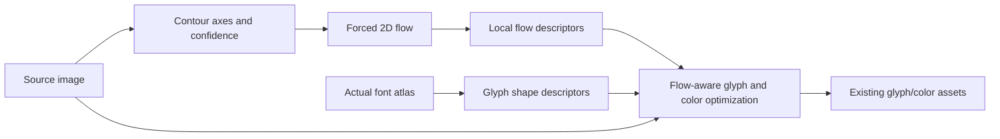

# Flow domains renderer — proposal for review

Implementation review: the first static version is available as `style="flow"`. Its default pool is 96 unique glyphs, every glyph remains available in every cell, and glyph variety defaults to 0.02. The selected flow influence is 0.4, eddy forcing 0.65, and domain size 6 character widths. Neighbor coherence comes from the shared field and spatially localized raster descriptors. The solver uses a padded periodic domain with spectral projection and diffusion; this replaces the proposed slip-wall boundary treatment. Comparison artifacts and a FLIP viewer are produced by `scripts/compare_flow.py` and `scripts/view_renders.py`.

The image supplies preferred flow axes and spatial guidance. A forced 2D velocity simulation develops coherent streams, bends, and eddies. Glyphs express the local shape of that flow, while the existing perceptual machinery fits their displayed brightness and color to the source image.

The intended appearance is broad regions of aligned strokes interrupted by curved, tangled patches: `=`, `|`, `/`, and `\` in straight streams; curved glyphs such as `G`, `O`, and `@` where the field turns within or around a cell. These are visual examples. Selection should measure the actual font rasters rather than assign universal meanings to character names.

The first version produces a static wallpaper, as requested. It simulates offline for a bounded warm-up and freezes a reproducible snapshot. An actively forced field need not converge to a steady state; “settled” means a developed field captured at a defined simulation time.

**1. Reuse the image's local orientation evidence.**

The current `SpatialMetrics.glyph_stroke_costs()` already builds multiscale OKLab bandpass direction tensors, including chromatic contours at equal luminance, and weights them by energy and coherence. Refactor that source-feature extraction into a reusable helper.

For each location, retain a preferred contour axis, confidence, and texture energy. A gradient points across a contour; the proposed flow follows its tangent, so convert the gradient-normal representation to a tangent representation consistently for source and glyph descriptors. Confidence should require both energy and directional coherence: a flat patch has little evidence, while a textured crossing has conflicting evidence.

These axes are unsigned: a horizontal contour says east–west, without choosing east or west. Use an alignment force that damps velocity perpendicular to the preferred axis. A seeded, smooth driving field supplies actual velocity direction. This avoids assigning independent signs to neighboring image axes. Weaken alignment near conflicting directions and low-confidence regions.

**2. Build a small forced-fluid solver.**

Use the existing PyTorch runtime for a 2D velocity grid with several samples per glyph. Respect image coordinates and the physical width/height of each cell so circular eddies remain circular with tall character cells.

The proposed dynamics combine self-advection, viscosity, drag, image-axis alignment, and seeded eddy forcing, with pressure projection to reduce divergence. Start from a stable-fluid update: forces, diffusion, projection, semi-Lagrangian self-advection, then projection again. This update structure follows [Stam's Real-Time Fluid Dynamics for Games](https://www.dgp.toronto.edu/people/stam/reality/Research/pdf/GDC03.pdf).

The force design is specific to this renderer:

- A smooth, seeded large-scale drive keeps the field moving.
- Confident contours damp motion across their tangent axis, making coherent flow domains follow the image.
- A bounded texture/conflict envelope adds more eddy forcing around directional conflicts and complex regions. Flat regions receive a modest background flow rather than maximum noise.
- Generate eddy forcing from the curl of a spatially modulated scalar potential. Modulating the potential before taking its curl preserves the divergence-free construction described in [Bridson et al., Curl-Noise for Procedural Fluid Flow](https://www.cs.ubc.ca/~rbridson/docs/bridson-siggraph2007-curlnoise.pdf).

For the first prototype, use a padded simulation domain with slip walls at its outer boundary and crop back to the image. Measure remaining border effects. Image contours are soft guides; any later interpretation as solid obstacles needs separate visual evaluation.

Use a fixed seed and step budget, and record simulation resolution and parameters. Bound the timestep and force amplitudes for accuracy as well as numerical stability. Pressure projection can change the guide alignment, so measure both divergence and alignment after projection rather than assuming both constraints are satisfied perfectly.

**3. Describe flow and glyph shape at compatible scales.**

Sample the frozen flow inside each glyph cell and across nearby cells. Describe its unsigned direction distribution, within-cell bending, and variation over a few cell widths. Retain spatial information: one average orientation cannot explain a curved glyph.

Compute comparable descriptors once from the actual antialiased atlas: stroke tangents, orientation spread, spatially localized turning, and coverage. Compare localized direction patterns so a straight cross and a curved loop do not receive identical scores merely because both contain several orientations. Use a descriptor preview to check whether the chosen font actually separates `=`, `|`, `+`, `G`, `O`, and `@` as intended.

| Flow appearance | Glyph preference |
| --- | --- |
| Straight, coherent stream | Straight strokes aligned with the local axis |
| Stream bending across a cell | Curved or mixed strokes matching the turn |
| Complex eddy neighborhood | Greater orientation spread and curved detail |
| Nearly stationary region | Attenuated flow cost; tone and image evidence dominate |

Vorticity is useful diagnostic information, but it is not a sufficient turbulence score. Orderly rotation can have high vorticity. Use curvature and multiscale directional variation to describe visual flow complexity, and attenuate normalized direction/curvature measures near zero speed.

**4. Keep flow geometry in the glyph objective; reuse perceptual color fitting.**

First produce a diagnostic render by selecting flow-matched, tone-feasible glyphs and calling the existing `fit_fixed_glyphs()` with perceptual fitting enabled. This isolates whether the field-to-glyph mapping achieves the intended appearance. Tone feasibility must account for coverage and attainable ink brightness, otherwise thin glyphs can be assigned to highlights they cannot reproduce.

For the production candidate, add cached flow/glyph costs to the current full-bank hard-choice solver. Apply them during initialization and every glyph optimization step. Every configured glyph remains available; flow preferences and perceptual image fidelity compete through explicit weights. Replace the new style's source stroke-alignment preference with flow alignment. Compare reduced source-contour weights during the experiment because strong original contour terms may suppress the intended flow texture.

Reuse spatial lightness, source-referenced hue/chroma preservation, bounded RGB8 ink fitting, background handling, grayscale, ink polarity, and the existing display transform. Color remains tied to the source image. Flow speed should not directly dictate darkness or glyph density. A final color-only fit can refine ink with glyphs fixed if the comparison demonstrates a benefit.

Include an atlas-derived cost for incompatible stroke directions near neighboring cell boundaries, weighted by flow confidence and weakened at domain boundaries. Compare this against per-cell matching alone: shared flow guidance may already provide enough continuity, and excessive continuity penalties can erase image details or force repeated characters.

**5. Review the visual experiment before integrating settings.**

Add a comparison script using the existing experiment helpers. Hold source, font, glyph bank, cell size, and color settings fixed across variants:

- Current perceptual renderer.
- Direct contour-guided field without fluid evolution.
- Simulated field with calm forcing.
- Simulated field with moderate and strong eddy forcing.
- Flow-selected glyphs with fixed-glyph color fitting versus flow-aware joint optimization.

Save full previews, enlarged glyph crops, streamline overlays, confidence/curvature maps, glyph distributions, perceptual brightness/chroma errors, elapsed time, and reproducibility metadata. Measure flow-to-glyph alignment and boundary continuity alongside image fidelity. Lower image error alone cannot establish that this style succeeds.

Use the repository's image fixtures and small synthetic cases: parallel contours, concentric contours, intersecting contours, an equal-luminance color boundary, and a flat image. Review multiple cell sizes and at least two fonts. Keep numerical checks focused on finite outputs, projection reducing divergence, aspect-correct geometry, seeded repeatability on the same backend, valid glyph indices, and zero-flow-weight behavior matching the existing solver configuration.

The first review gate is visual: recognizable source colors and subject, visible streams spanning multiple cells, curved glyphs around flow turns, and localized complexity rather than frame-wide noise. Publish measured runtime overhead with the comparison; select budgets after observing actual cost.

**6. Add a dedicated style after choosing the visual behavior.**

Expose **Flow domains** as `style="flow"` in the CLI, service, profiles, and Plasma settings. Start with three appearance controls:

| Control | Effect |
| --- | --- |
| Flow influence | Strength of flow geometry in glyph selection |
| Eddy strength | Amount of complex rotational forcing |
| Domain size | Spatial scale of streams and eddies, measured relative to glyph cells |

Keep viscosity, solver resolution, timestep, and warm-up budgets internal initially. Image guidance should be strong by default; vary its strength in the experiment before deciding whether it deserves another user-facing control.

Provide a flow-specific default bank containing the straight, curved, and dense glyphs used in the experiment, including `@`, which is absent from the current standard default. Preserve custom character lists. A limited custom bank receives the closest available shape rather than failing because a preferred glyph is missing.

Integration must update option validation, style dispatch, profile serialization/defaults, configuration controls, manifest metadata, and cache signatures. Add the flow module to `revision.py`'s explicit renderer file list so algorithm changes invalidate cached assets. Include all effective flow parameters and the seed in cache identities.

Emit the existing glyph/color/background assets, keeping the current playback format. Existing slideshow transitions can connect flow-rendered stills using the current glyph-path machinery and perceptual fixed-glyph color fitting; evolving flow and flow-specific transitions are future extensions.

The implementation order is source/atlas descriptors → numerical flow prototype → diagnostic glyph/color renders → visual comparison and weight selection → production solver integration → settings and documentation. The proposed design assumes a recognizable image with conspicuous flow texture; the comparison should also include a stronger interpretation so that artistic balance can be reviewed directly.
